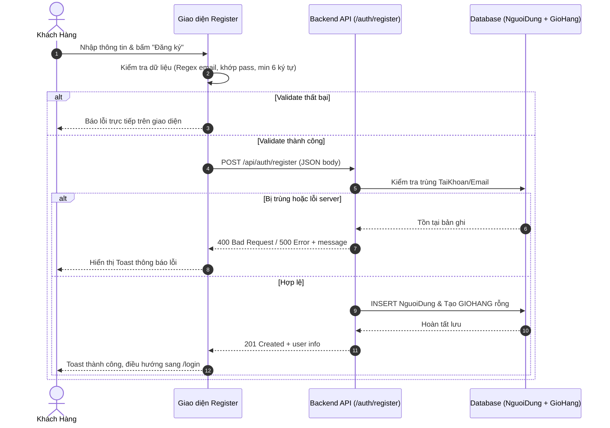

# Hướng Dẫn Tích Hợp Tính Năng Đăng Ký Cho Front-End

Tài liệu này cung cấp chi tiết kỹ thuật cho đội ngũ Front-End (FE) tích hợp tính năng **Đăng ký tài khoản (Register)** với RESTful API backend của hệ thống e-commerce.

---

## 1. Thông Tin Endpoint API

- **URL:** `POST /api/auth/register` (hoặc `http://localhost:5000/api/auth/register`)
- **Headers:** `Content-Type: application/json`
- **Quyền hạn (Auth):** Public (Không yêu cầu Bearer Token)

---

## 2. Cấu Trúc Request Body

Payload gửi lên dạng JSON:

```json
{
  "TaiKhoan": "nguyenvana",
  "MatKhau": "MatKhau123",
  "TenKH": "Nguyễn Văn A",
  "SDT": "0987654321",
  "Email": "nguyenvana@example.com"
}
```

### Chi tiết các trường:

| Tên trường | Kiểu dữ liệu | Bắt buộc | Ràng buộc FE & Ý nghĩa |
| :--- | :--- | :---: | :--- |
| `TaiKhoan` | `string` | **Có** | Tên đăng nhập (duy nhất trong hệ thống). Không chứa khoảng trắng. |
| `MatKhau` | `string` | **Có** | Mật khẩu tài khoản (tối thiểu 6 ký tự). |
| `TenKH` | `string` | **Có** | Họ và tên đầy đủ của khách hàng. |
| `Email` | `string` | **Có** | Email hợp lệ (duy nhất trong hệ thống). |
| `SDT` | `string` | Không | Số điện thoại liên hệ (10 ký tự số chuẩn VN). |

---

## 3. Quy Ước Response & Mã Lỗi

### 3.1. Phản hồi thành công (`201 Created`)

Khi tạo tài khoản thành công, hệ thống tự động khởi tạo 1 Giỏ hàng (`GIOHANG`) rỗng cho khách hàng và trả về thông tin cơ bản:

```json
{
  "message": "Đăng ký tài khoản thành công.",
  "user": {
    "MaKH": 12,
    "TaiKhoan": "nguyenvana",
    "TenKH": "Nguyễn Văn A",
    "Email": "nguyenvana@example.com"
  }
}
```

### 3.2. Lỗi dữ liệu đầu vào hoặc trùng lặp (`400 Bad Request`)

- **Thiếu trường bắt buộc:**
  ```json
  {
    "message": "Vui lòng điền đầy đủ các thông tin bắt buộc."
  }
  ```
- **Tài khoản hoặc Email đã tồn tại:**
  ```json
  {
    "message": "Tên tài khoản hoặc Email đã được sử dụng."
  }
  ```

### 3.3. Lỗi hệ thống máy chủ (`500 Internal Server Error`)

```json
{
  "message": "Lỗi máy chủ trong quá trình đăng ký."
}
```

---

## 4. Ràng Buộc Xác Thực Phía Front-End (Client Validation)

Trước khi gửi request qua API, FE cần xác thực ngay trên form:
1. **Kiểm tra rỗng:** `TaiKhoan`, `TenKH`, `Email`, `MatKhau` không được để trống.
2. **Độ dài mật khẩu:** Tối thiểu 6 ký tự (`MatKhau.length >= 6`).
3. **Mật khẩu nhập lại (`confirmPassword`):** So khớp chính xác với `MatKhau`.
4. **Định dạng Email:** Kiểm tra regex (ví dụ: `/^[^\s@]+@[^\s@]+\.[^\s@]+$/`).
5. **Trạng thái nút submit:** Set `disabled` và hiển thị spinner/loading để ngăn chặn người dùng spam click nhiều lần (double submit).

---

## 5. Hướng Dẫn Code Mẫu (React + Axios)

### 5.1. Tầng Service / Context

Tích hợp hàm gọi API vào service chung (tham khảo [AuthContext.jsx](file:///d:/e-commerce-1/frontend/src/context/AuthContext.jsx)):

```javascript
import api from '../services/api';

export const registerUser = async (userData) => {
  try {
    const response = await api.post('/auth/register', userData);
    return {
      success: true,
      data: response.data,
      message: response.data.message
    };
  } catch (error) {
    const errMsg = error.response?.data?.message || 'Đăng ký tài khoản thất bại. Vui lòng thử lại sau.';
    return {
      success: false,
      message: errMsg
    };
  }
};
```

### 5.2. Luồng xử lý submit tại Component Register

Tham khảo trực tiếp [Register.jsx](file:///d:/e-commerce-1/frontend/src/pages/Register.jsx):

```javascript
const handleSubmit = async (e) => {
  e.preventDefault();
  const { TaiKhoan, TenKH, Email, SDT, MatKhau, confirmPassword } = formData;

  // 1. Client Validation
  if (!TaiKhoan || !TenKH || !Email || !MatKhau) {
    showToast('error', 'Vui lòng điền đầy đủ các thông tin bắt buộc.');
    return;
  }
  if (MatKhau.length < 6) {
    showToast('error', 'Mật khẩu phải chứa ít nhất 6 ký tự.');
    return;
  }
  if (MatKhau !== confirmPassword) {
    showToast('error', 'Mật khẩu xác nhận không khớp.');
    return;
  }

  // 2. Call API
  setIsSubmitting(true);
  const result = await registerUser({ TaiKhoan, TenKH, Email, SDT, MatKhau });
  setIsSubmitting(false);

  // 3. Handle Result
  if (result.success) {
    showToast('success', 'Đăng ký thành công! Đang chuyển hướng sang đăng nhập...');
    setTimeout(() => {
      navigate('/login');
    }, 1500);
  } else {
    showToast('error', result.message);
  }
};
```

---

## 6. Luồng Trải Nghiệm Người Dùng (UX Flow)


