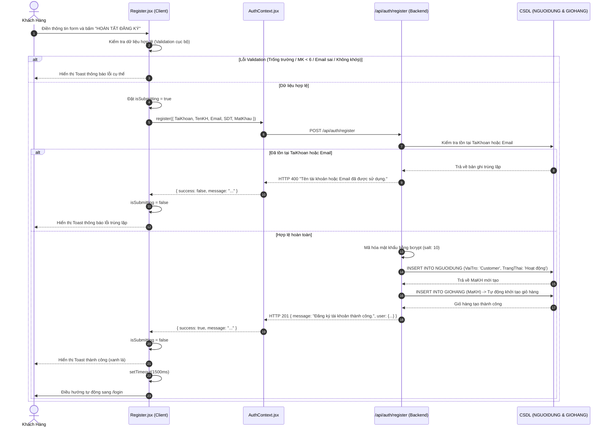

# Tài Liệu Phân Tích Giao Diện Đăng Ký Tài Khoản (Register UI Analysis)

> **Dự án**: Sàn Thương Mại Điện Tử CellphoneS Style  
> **Tài liệu**: Phân tích chi tiết giao diện và luồng nghiệp vụ Đăng ký tài khoản  
> **Vị trí file mã nguồn**: [`frontend/src/pages/Register.jsx`](file:///d:/e-commerce-1/frontend/src/pages/Register.jsx)  
> **Route URL**: `/register`  
> **Ngày cập nhật**: 27/10/2026  

---

## 1. Tổng Quan & Định Vị Thương Hiệu

Giao diện Đăng ký tài khoản đóng vai trò là điểm chạm đầu tiên (entry point) để chuyển đổi khách vãng lai thành người dùng có tài khoản trên hệ thống. 

### 1.1. Mục tiêu giao diện
- **Đơn giản & Rõ ràng**: Thu thập các thông tin tối thiểu cần thiết để tạo lập danh tính khách hàng mà không gây rào cản hay quá tải thông tin.
- **Tập trung & Tối ưu chuyển đổi**: Thiết kế dạng hộp thẻ (Card-based Layout) nằm giữa màn hình, loại bỏ các chi tiết gây xao nhãng xung quanh.
- **Nhận diện thương hiệu chuẩn CellphoneS**: Gắn liền với quyền lợi chương trình thành viên **Smember**, sử dụng sắc đỏ thương hiệu (`#d70018` và gradient `#be0015`), font chữ hiện đại sans-serif (Roboto/Inter) và phong cách nền sáng sạch sẽ (`#f4f8fc`).

---

## 2. Phân Tích Bố Cục & Cấu Trúc UI (UI Architecture)

Giao diện được xây dựng bằng React kết hợp với Tailwind CSS, sử dụng bộ icon từ `lucide-react`.

```
+-------------------------------------------------------------+
| Nền toàn trang: #f4f8fc (min-h-[80vh], căn giữa flexbox)    |
|                                                             |
|   +-----------------------------------------------------+   |
|   | Header: Gradient Đỏ (#d70018 -> #be0015)            |   |
|   | [Icon Zap] ĐĂNG KÝ THÀNH VIÊN SMEMBER               |   |
|   | Phụ đề quyền lợi ưu đãi & giảm giá công nghệ        |   |
|   +-----------------------------------------------------+   |
|   | Form Nhập Liệu (Lưới 2 cột trên Desktop/Tablet):    |   |
|   | 1. [User]  Tên tài khoản   | 2. Họ và tên đầy đủ    |   |
|   | 3. [Mail]  Địa chỉ Email   | 4. [Phone] Số ĐT       |   |
|   | 5. [Lock]  Mật khẩu [Eye]  | 6. [Lock] Xác nhận MK  |   |
|   |                                                     |   |
|   | [ HOÀN TẤT ĐĂNG KÝ (Nút đỏ full-width) ]            |   |
|   |                                                     |   |
|   | --------------------------------------------------- |   |
|   | Đã có tài khoản? [Đăng nhập ngay (/login)]          |   |
|   +-----------------------------------------------------+   |
+-------------------------------------------------------------+
```

### 2.1. Container & Card Wrapper
- **Khung chứa ngoài (`Outer Wrapper`)**: `w-full bg-[#f4f8fc] min-h-[80vh] flex items-center justify-center px-4 py-10`
  - Đảm bảo form luôn được căn giữa màn hình theo cả chiều dọc và ngang, có khoảng đệm tương thích trên cả thiết bị di động nhỏ.
- **Thẻ biểu mẫu (`Card Container`)**: `w-full max-w-lg bg-white rounded-md shadow-sm border border-slate-200 overflow-hidden`
  - Độ rộng tối đa `32rem` (`max-w-lg`), bo góc vừa phải (`rounded-md`), viền xám nhẹ giữ cảm giác phẳng, tinh gọn và thanh lịch.

### 2.2. Khối Header Thương Hiệu (Brand Header)
- **Nền & Màu sắc**: `bg-gradient-to-r from-[#d70018] to-[#be0015] text-white p-6 text-center`
- **Huy hiệu biểu tượng**: Hộp vuông màu trắng bo góc `w-10 h-10 rounded-md bg-white text-[#d70018]` chứa biểu tượng sấm sét `<Zap className="w-5 h-5 fill-[#d70018]" />`, tượng trưng cho sự nhanh chóng và năng lượng của CellphoneS/Smember.
- **Tiêu đề**: "ĐĂNG KÝ THÀNH VIÊN SMEMBER" (`text-xl font-black uppercase tracking-tight`).
- **Thông điệp giá trị (Value Proposition)**: "Nhận ngay đặc quyền thành viên và ưu đãi giảm giá công nghệ độc quyền" (`text-xs text-rose-100`).

### 2.3. Các Trường Nhập Liệu (Form Inputs)
Các trường được chia thành 3 hàng theo lưới `grid grid-cols-1 sm:grid-cols-2 gap-3`, giúp form hiển thị gọn gàng trên màn hình lớn và xếp chồng linh hoạt trên di động.

| STT | Tên trường | Biến dữ liệu | Loại input | Icon hỗ trợ | Placeholder | Ràng buộc bắt buộc |
|:---:|:---|:---|:---:|:---:|:---|:---:|
| 1 | Tên tài khoản | `TaiKhoan` | `text` | `User` | `VD: nguyenvana` | Có (`*`, `required`) |
| 2 | Họ và tên | `TenKH` | `text` | *Không* | `VD: Nguyễn Văn A` | Có (`*`, `required`) |
| 3 | Địa chỉ Email | `Email` | `email` | `Mail` | `email@domain.com` | Có (`*`, `required`) |
| 4 | Số điện thoại | `SDT` | `tel` | `Phone` | `0912345678` | Có (`*`, `required`) |
| 5 | Mật khẩu | `MatKhau` | `password`/`text` | `Lock` + `Eye/EyeOff` | `••••••••` | Có (`*`, `min: 6`) |
| 6 | Xác nhận mật khẩu | `confirmPassword` | `password`/`text` | `Lock` | `••••••••` | Có (`*`, khớp MK) |

### 2.4. Trạng Thái Nút Thao Tác (Call-to-Action)
- Nút submit chính: `w-full bg-[#d70018] hover:bg-[#be0015] text-white font-bold py-2.5 rounded-[4px] text-xs uppercase tracking-wide transition-colors shadow-sm`
- **Trạng thái bình thường**: Văn bản `"HOÀN TẤT ĐĂNG KÝ"`.
- **Trạng thái đang gửi (`isSubmitting === true`)**:
  - Thuộc tính `disabled={true}`, giảm opacity (`disabled:opacity-60`).
  - Văn bản chuyển thành `"ĐANG TẠO TÀI KHOẢN..."`.
  - Ngăn chặn triệt để tình trạng click lặp lại (double-submit) tạo nhiều request trùng lặp.

### 2.5. Điều Hướng Liên Kết Phụ
- Cuối form có đường kẻ phân cách mảnh `border-t border-slate-100` và văn bản hỗ trợ:
  - `"Đã có tài khoản thành viên?"` kèm đường dẫn [`Đăng nhập ngay`](file:///d:/e-commerce-1/frontend/src/pages/Login.jsx) trỏ về `/login` với màu đỏ thương hiệu `#d70018` và hiệu ứng gạch chân khi hover.

---

## 3. Kiến Trúc Kỹ Thuật & Luồng Dữ Liệu (Data Flow)

### 3.1. Sơ Đồ Trình Tự Thực Thi (Sequence Diagram)



### 3.2. Quản Lý State (Local State Management)
Trong component [`Register.jsx`](file:///d:/e-commerce-1/frontend/src/pages/Register.jsx):
- `formData`: Object lưu trữ giá trị 6 trường (`TaiKhoan`, `TenKH`, `Email`, `SDT`, `MatKhau`, `confirmPassword`).
- `showPassword`: Boolean điều khiển trạng thái hiển thị `text` hoặc `password` của trường mật khẩu.
- `isSubmitting`: Quản lý trạng thái đang gửi request API.
- `toast`: Object chứa `{ type, message }` để hiển thị component [`Toast`](file:///d:/e-commerce-1/frontend/src/components/Toast.jsx).

### 3.3. Tầng Tích Hợp Backend (Backend Service & Database)
- **Controller**: [`backend/controllers/authController.js:register`](file:///d:/e-commerce-1/backend/controllers/authController.js#L9-L60)
- **Bảng CSDL liên quan**:
  1. `NGUOIDUNG`:
     - `MaKH` (Khóa chính, tự tăng)
     - `TaiKhoan` (VARCHAR(100), UNIQUE, bắt buộc)
     - `MatKhau` (VARCHAR, đã hash bcrypt, bắt buộc)
     - `TenKH` (VARCHAR, bắt buộc)
     - `SDT` (VARCHAR(20), tùy chọn/bắt buộc qua form)
     - `Email` (VARCHAR(100), UNIQUE, bắt buộc)
     - `VaiTro` (Mặc định: `'Customer'`)
     - `TrangThai` (Mặc định: `'Hoạt động'`)
  2. `GIOHANG`:
     - Tự động tạo bản ghi giỏ hàng mới liên kết với `MaKH` vừa đăng ký, giúp khách hàng có thể mua sắm ngay lập tức sau khi đăng nhập mà không gặp lỗi thiếu giỏ hàng.

---

## 4. Chi Tiết Các Quy Chuẩn Kiểm Tra (Validation Rules)

| Tiêu chí | Cấp độ kiểm tra | Quy tắc kiểm tra | Thông báo lỗi |
|---|:---:|---|---|
| **Thông tin bắt buộc** | Client & Server | `!TaiKhoan \|\| !TenKH \|\| !Email \|\| !MatKhau` | `"Vui lòng điền đầy đủ các thông tin bắt buộc."` |
| **Độ dài mật khẩu** | Client | `MatKhau.length < 6` | `"Mật khẩu phải chứa ít nhất 6 ký tự."` |
| **Xác nhận mật khẩu** | Client | `MatKhau !== confirmPassword` | `"Mật khẩu xác nhận không khớp."` |
| **Định dạng Email** | Client | Regex: `/^[^\s@]+@[^\s@]+\.[^\s@]+$/` | `"Định dạng Email không hợp lệ."` |
| **Trùng tên tài khoản hoặc Email** | Server (DB) | `[Op.or]: [{ TaiKhoan }, { Email }]` | `"Tên tài khoản hoặc Email đã được sử dụng."` |
| **Lỗi hệ thống bất khả kháng** | Server (Catch) | Lỗi kết nối CSDL / Exception | `"Lỗi máy chủ trong quá trình đăng ký."` |

---

## 5. Đánh Giá Trải Nghiệm Người Dùng (UX/UI Evaluation)

### 5.1. Điểm mạnh (Strengths)
1. **Đồng bộ nhận diện thương hiệu tuyệt vời**: Header gradient đỏ CellphoneS cùng định vị hội viên Smember giúp gia tăng cảm xúc uy tín và tạo cảm giác nhận được quyền lợi công nghệ ngay từ bước đăng ký.
2. **Bố cục 2 cột khoa học**: Tận dụng tốt không gian màn hình, giảm chiều cao cuộn trang (scroll height), tạo cảm giác form ngắn gọn, dễ hoàn thành.
3. **Phản hồi người dùng trực quan**: 
   - Có nút ẩn/hiện mật khẩu dạng icon con mắt (`Eye`/`EyeOff`).
   - Có trạng thái `disabled` và nhãn `"ĐANG TẠO TÀI KHOẢN..."` tránh double click.
   - Sử dụng Toast nổi thông báo lỗi và thành công rõ ràng.
4. **Xử lý trọn vẹn luồng dữ liệu**: Backend tự động khởi tạo giỏ hàng rỗng (`GIOHANG`) đi kèm cho tài khoản mới, loại bỏ lỗi null pointer khi chuyển sang màn hình mua sắm.

### 5.2. Các điểm hạn chế & Rủi ro tồn tại (Areas for Improvement)
1. **Thiếu kiểm tra định dạng Số điện thoại phía Client**: Form đang dùng `type="tel"` nhưng chưa có regex xác thực số điện thoại chuẩn Việt Nam (10 số, đầu số 03, 05, 07, 08, 09).
2. **Trường xác nhận mật khẩu chưa có nút ẩn/hiện riêng**: Hiện tại icon con mắt ở trường Mật khẩu chính điều khiển ẩn/hiện cho cả 2 ô hoặc ô xác nhận mật khẩu phụ thuộc trạng thái này, có thể gây khó quan sát nếu người dùng chỉ muốn kiểm tra ô xác nhận.
3. **Thông báo lỗi tập trung trên Toast thay vì Inline Error**: Khi xảy ra lỗi (ví dụ email sai định dạng), lỗi hiển thị trên popup Toast ở góc thay vì viền đỏ và dòng chữ báo lỗi trực tiếp ngay bên dưới input tương ứng, làm giảm tốc độ nhận biết vị trí lỗi của người dùng.
4. **Chưa có thang đo độ mạnh mật khẩu (Password Strength Meter)**: Hiện mới chỉ ràng buộc >= 6 ký tự mà chưa khuyến nghị kết hợp chữ hoa, chữ thường, số và ký tự đặc biệt.
5. **Chưa có Checkbox Điều khoản & Chính sách**: Thiếu cam kết tuân thủ "Điều khoản sử dụng và Chính sách bảo mật thông tin", vốn là yêu cầu quan trọng trong thương mại điện tử và pháp lý dữ liệu người dùng.
6. **Sau khi đăng ký thành công phải đăng nhập lại**: Hệ thống chuyển hướng về `/login` thay vì tự động phát hành JWT Token và đăng nhập ngay cho khách hàng.

---

## 6. Đề Xuất Nâng Cấp & Hoàn Thiện (Actionable Recommendations)

Dưới đây là các khuyến nghị nâng cấp mã nguồn theo thứ tự ưu tiên:

### 6.1. Bổ sung Regex số điện thoại Việt Nam (Độ ưu tiên: Cao)
```javascript
// Đề xuất thêm vào hàm handleSubmit trong Register.jsx
const phoneRegex = /(84|0[3|5|7|8|9])+([0-9]{8})\b/;
if (!phoneRegex.test(SDT)) {
  setToast({ type: 'error', message: 'Số điện thoại không đúng định dạng (VD: 0912345678).' });
  return;
}
```

### 6.2. Hiển thị Inline Error dưới từng ô input (Độ ưu tiên: Trung bình)
- Bổ sung state `errors: {}` để lưu trữ lỗi theo từng field.
- Khi người dùng gõ sai hoặc submit lỗi, input được gán class `border-red-500 focus:border-red-500` và hiển thị `<p className="text-[11px] text-red-600 mt-1">{errors.fieldName}</p>`.

### 6.3. Bổ sung Checkbox Điều khoản dịch vụ (Độ ưu tiên: Trung bình)
- Thêm trường checkbox:
  ```jsx
  <label className="flex items-center gap-2 text-xs text-slate-600 cursor-pointer">
    <input type="checkbox" required className="accent-[#d70018] rounded" />
    <span>Tôi đồng ý với <Link to="/terms" className="text-[#d70018] underline">Điều khoản sử dụng</Link> và <Link to="/privacy" className="text-[#d70018] underline">Chính sách Smember</Link></span>
  </label>
  ```

### 6.4. Hỗ trợ Đăng nhập xã hội (Social Login) (Độ ưu tiên: Tương lai)
- Bổ sung nút đăng ký nhanh qua **Google** hoặc **Facebook** bằng OAuth2, giúp giảm tỷ lệ bỏ rơi form (form abandonment rate) xuống 40-60%.

---

## 7. Bảng Tổng Hợp Thông Tin Mã Nguồn

| Hạng mục | Chi tiết |
|---|---|
| **Component File** | [`frontend/src/pages/Register.jsx`](file:///d:/e-commerce-1/frontend/src/pages/Register.jsx) |
| **Auth Context** | [`frontend/src/context/AuthContext.jsx`](file:///d:/e-commerce-1/frontend/src/context/AuthContext.jsx) |
| **Backend Route** | `POST /api/auth/register` trong [`backend/server.js`](file:///d:/e-commerce-1/backend/server.js) |
| **Backend Controller** | [`backend/controllers/authController.js`](file:///d:/e-commerce-1/backend/controllers/authController.js) |
| **Model CSDL** | `NguoiDung`, `GioHang` trong [`backend/models/index.js`](file:///d:/e-commerce-1/backend/models/index.js) |
| **Màu thương hiệu** | Đỏ `#d70018`, Đỏ đậm hover `#be0015`, Nền phụ `#f4f8fc` |
| **Typography** | Font sans-serif, kích thước nhãn `text-xs font-bold`, tiêu đề `text-xl font-black` |
| **Bộ Icon** | `User`, `Mail`, `Phone`, `Lock`, `Eye`, `EyeOff`, `Zap` (từ `lucide-react`) |
